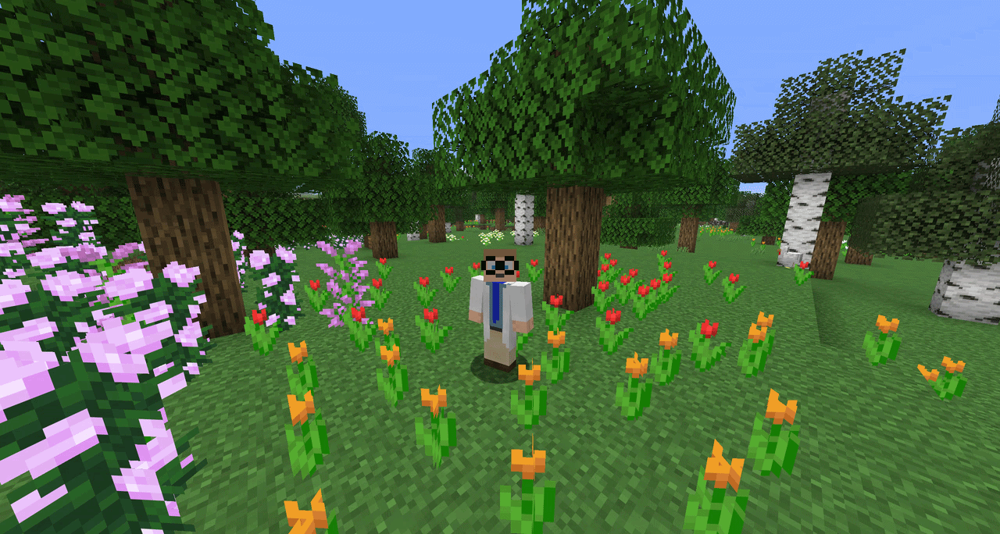
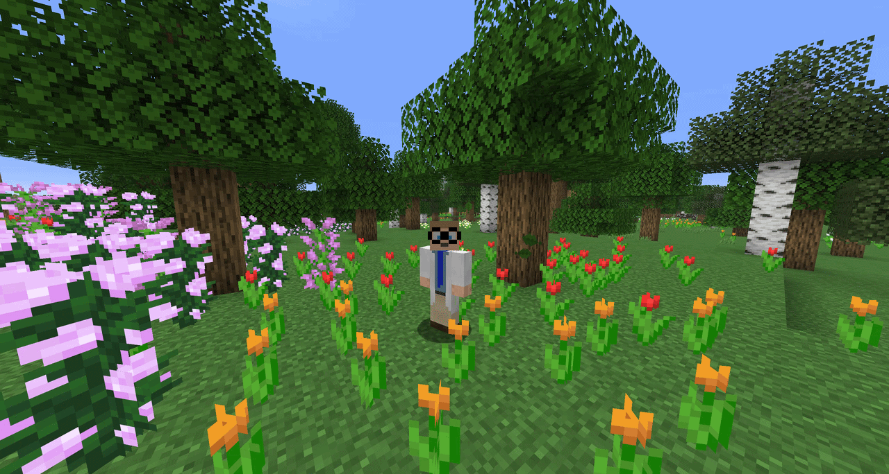

# Simple Voice Animations

Animates player heads using [Simple Voice Chat](https://modrinth.com/mod/simple-voice-chat).

Each player chooses their own animation style.
If the mod is installed on the server, everyone's animation settings are synced to all other players.
Players without the mod on their client use the style set in the `default_head_animation_style` server config option.
On servers without the mod, your own animation settings are applied to all other players instead (can be disabled with the `fallback_to_own_animations` config option).

## Animation Styles

**Scale Height** - The head stretches vertically while talking.

**Scale** - The whole head scales up and down while talking.

**Split Head (Hinge)** - The head splits open like a jaw.

**Split Head (Vertical)** - The upper part of the head lifts straight up.

The split height is configurable for both split styles.

## Usage

Press `J` (configurable in the Minecraft key bindings) to open the settings screen.
Choose your animation style and drag the bar in the preview to set where your head splits.

## Requirements

- [Simple Voice Chat](https://modrinth.com/mod/simple-voice-chat)
- [ModMenu](https://modrinth.com/mod/modmenu) (Optional)
